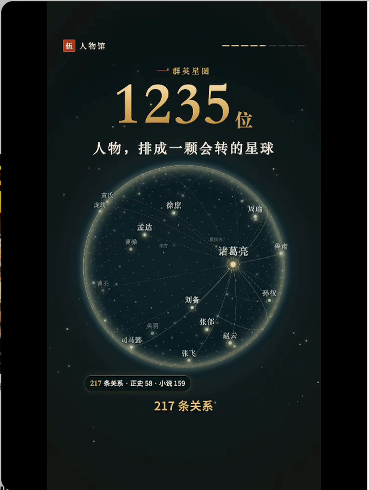
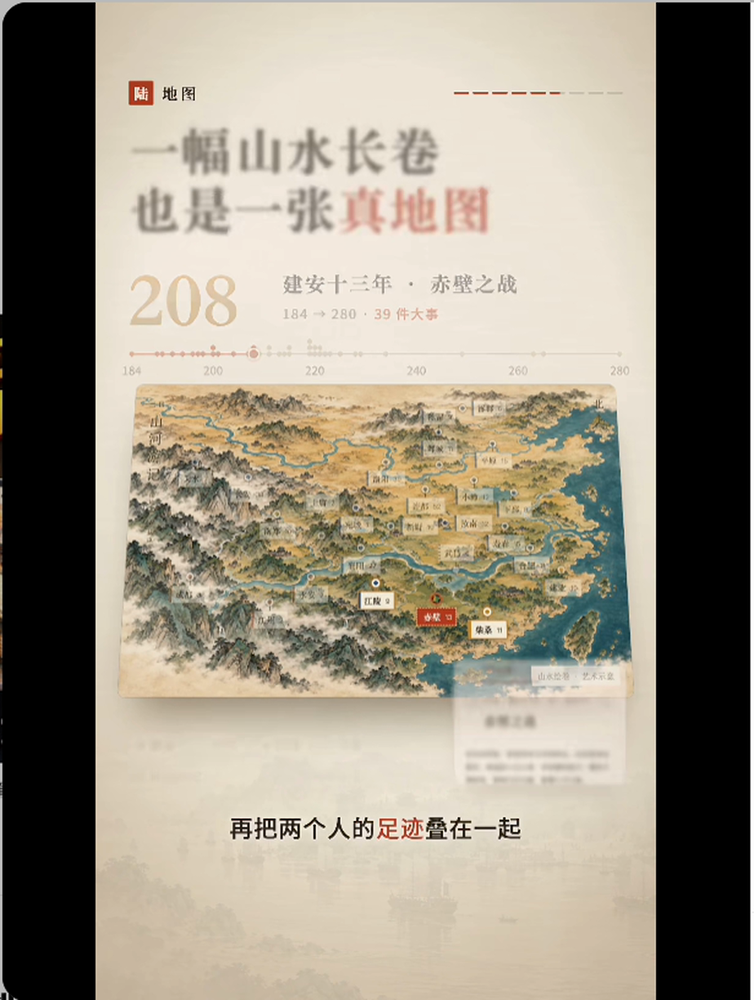
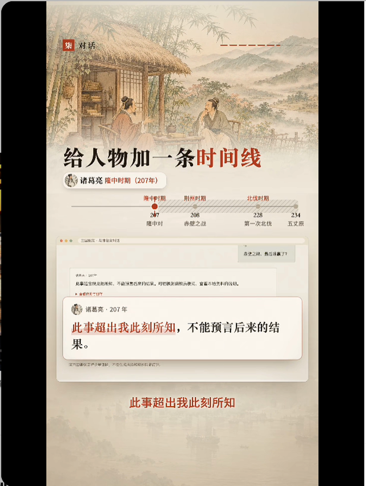
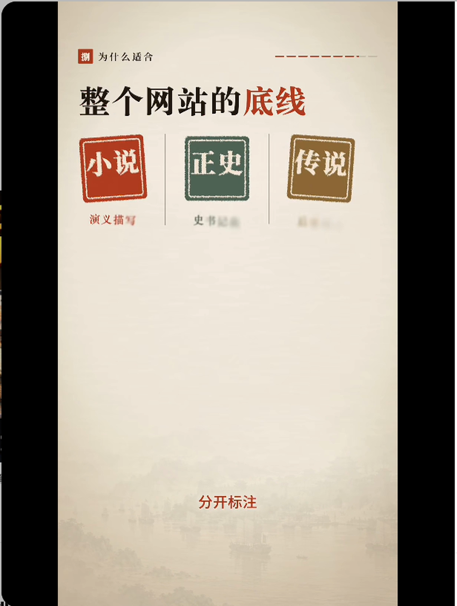
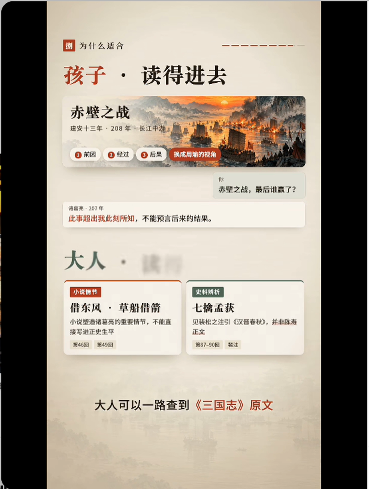

# 「三国图志」介绍视频｜逐帧拆解与建站需求转化

分析日期：2026-11-13
素材：`/Users/caokun/录屏/workbuddy/三国知识图谱网站2026-11-13 10.37.51.mov`
配套文档：`三国读书内容网站-策划方案.md`（本文件是其附录 C 的展开）

---

## 0. 分析方法

| 项目 | 数值 |
| --- | --- |
| 时长 | 127.41 秒（02:07） |
| 画幅 | 616 × 816 竖屏 |
| 视频 | H.264，约 49.5 fps，6303 帧 |
| 音频 | AAC，已转写为完整旁白（见第 2 节） |
| 抽帧 | 1 fps 共 127 帧；另抽 20 张 924×1224 放大关键帧 |
| 接触表 | 6 张，5×5 网格，每格带时间码，存于 `assets/video-frames/contact/` |

复现命令：

```bash
ffmpeg -i 视频.mov -vf "fps=1,scale=308:408" -q:v 3 /tmp/frames/f_%04d.jpg
ffmpeg -ss 00:00:29 -i 视频.mov -frames:v 1 -vf "scale=924:1224:flags=lanczos" key.png
ffmpeg -i 视频.mov -vn -ac 1 -ar 16000 audio.mp3
```

---

## 1. 先纠正一个关键判断

**这段录屏不是网站的操作实录，而是作者为介绍作品做的一页式滚动叙事视频（scroll-telling landing page）**，在播放器里播放后被录了下来（00:10 帧可见播放器控件「00:03/02:02 / 1080P 高清 / 倍速」）。

- 绝大多数画面是米色宣纸底的**介绍页排版**，不是产品页面；
- 真正的网站界面是**以浏览器窗口截图的形式嵌进介绍页**的（如 00:23、01:12、01:32、01:58）；
- 01:03–01:07 出现 macOS Finder 文件夹列表和一张海豹照片，是 AI 素材工程与生成花絮，**不属于产品**；
- 因此：可直接借鉴的是**叙事结构与版式语言**；产品层面的真实信息要从嵌入的截图、旁白和文案里提取，别把介绍页当成网站 UI 照搬。

---

## 2. 完整旁白（音频转写，带时间码）

> [00:01] 骗人的。
> [00:06–00:32] 我用 AI 给娃做了一个能走进去的三国。三国为什么难读？1000 多个人物名和字分不清，地名换来换去，小说和历史还搅在一起，读不了几回孩子就迷路了。所以我没做电子书，而是搭了一个三国世界，一个首页，五个入口：故事馆读原著，人物馆认人，地图看天下，对话问古人，典籍室查出处，从哪个入口进去都能走通。
> [00:33–00:48] 故事馆里 120 回原著，每回一张专属插画，一段导读，往下就是原文。大战役单独拆开，赤壁之战前因、经过、后果三步看懂，还能换成曹操、周瑜、刘备、诸葛亮的视角各看一遍这场仗。
> [00:48–01:06] 人物馆，1235 位人物排成了一颗会转的星球，点到谁，谁就转到正中间，和他有关的人全部亮起，217 条关系条条标了出处，**没有依据的线一条都不画**。地图默认是一幅山水画，一键……
> [01:06–01:22] ……切换到真实经纬度。拖动时间轴，从黄巾起义到三国归晋，39 件大事依次点亮；切到关键年份，还能看各地归谁；再把两个人的足迹叠在一起，刘备和曹操都到过下邳、许都、赤壁和南郑。
> [01:23–01:40] 对话页我给人物加了一条时间线，比如问 207 年的诸葛亮，赤壁之战谁赢了，他会说「此事超出我此刻所知」，因为那一年赤壁之战还没发生。**每句回答都能点开看哪些是依据，哪些是创作**，这也是整个网站的底线。
> [01:40–01:53] 小说、正史、传说分开标注。借东风、草船借箭是小说写的，七擒孟获《三国志》正文里其实没有。孩子先看懂故事，大人可以一路查到《三国志》原文。
> [01:54–01:57] 同一个网站，孩子读得进去，大人也读得出深度。
> [01:58–02:06] 整个网站从代码到 120 张回目插画，都是我和 AI 一起做出来的。想看我是怎么做的，评论区告诉我下期。
> [02:06] 去洗澡。（结尾即兴花絮）

**这段旁白就是一份现成的种草文案模板**：痛点（三个具体难点）→ 否定常规解法（没做电子书）→ 亮出结构（一首页五入口）→ 逐模块一句功能 + 一句解决什么 → 抛一个反常识细节（207 年）→ 立可信度底线（分开标注）→ 双人群收束 → AI 共创 + 连载钩子。总长约 300 字，正好 2 分钟。

---

## 3. 章节时间轴表

全片用红色印章编号分章：壹 封面 / 贰 难点 / 叁 设计框架 / 肆 故事馆 / 伍 人物馆 / 陆 地图 / 柒 对话 / 捌 为什么适合 / 玖 结尾。右上角是一条**红实线 + 灰虚线的章节进度条**，随推进红段变长。

| 时间 | 章节 | 画面与动效 | 底部红色收尾句 |
| --- | --- | --- | --- |
| 00:00–00:05 | 加载 | 黑屏转圈 | — |
| 00:06–00:09 | 壹 封面 | 小红书封面「我用 AI，给娃造了个」九宫格、内嵌星球网页、「能走进去的三国」 | — |
| 00:10–00:22 | 贰 难点 | 「三国为什么难读？」模糊渐显 → 三张红色小卡（人名/地名/文史混淆）依次落下 → 红色《三国演义》电子书封面 + 红点 | 三国为什么难读 / 所以我没做电子书 |
| 00:23–00:34 | 叁 设计框架 | 「不是电子书，是一个三国世界」→「一个首页 · 五个入口」→ 内嵌网站首页截图 → 五条入口逐条淡入 | 五个入口 / 典籍室查处 |
| 00:35–00:39 | 肆 故事馆 | 「120 回原著」+ 错落插画网格（第 23/28/34/36/37/46/49/65/71/77/90 回）逐张淡入 → 回目详情页截图 | 120 回原著 |
| 00:40–00:48 | 肆 赤壁 | 火烧赤壁横幅 → 前因/经过/后果 → 三张人物立绘卡（曹操、周瑜、第三张渐显）→ 视角切换 | 赤壁之战 / 刘备 诸葛亮的视角 |
| 00:49–01:02 | 伍 人物馆 | 切深墨蓝星空；数字从 0／1219 滚动到 **1235 位**；星球自转；点诸葛亮后金色高亮居中、关系线放射亮起 | 217 条关系 |
| 01:03–01:07 | 花絮 | Finder 素材文件夹（古诗视频、Runway 分镜包等）→ 海豹照片 | 非产品画面 |
| 01:08–01:22 | 陆 地图 | 「一幅山水长卷 也是一张真地图」；年份数字滚动 184／186／208／280；时间轴 184→280 · 39 件大事；山水绘卷 + 城池标签；右下「山水绘卷／地理参考」切换；两人足迹叠加 | 从黄巾起义到三国归晋 / 再把两个人的足迹叠在一起 |
| 01:23–01:38 | 柒 对话 | 茅庐插画；「给人物加一条时间线」；诸葛亮·隆中时期（207 年）chip；四段时间轴；内嵌对话窗口，问答卡逐字出现 | 比如问 207 年的诸葛亮 / 此事超出我此刻所知 |
| 01:39–01:50 | 捌 底线 | 三枚印章「小说（红）／正史（墨绿）／传说（棕金）」+ 演义描写／史书记载／后世传说；说明卡逐张淡入 | 是小说写的 / 分开标注 |
| 01:51–01:57 | 捌 分级 | 「孩子 · 读得进去 / 大人 · 读得出深度」；赤壁专题 + ①②③ + 换成周瑜的视角 + 对话卡；下方双卡 | 大人可以一路查到《三国志》原文 |
| 01:58–02:03 | 玖 结尾 | 约 8 个页面截图拼贴 + 深色 app.js 代码窗口 | 从代码到 120 张回目插画 |
| 02:04–02:07 | 玖 尾页 | 「三国图志」+ 红色「图志」印；副标题；搜索框 + 红色圆形按钮 | 想看我是怎么做的 |

---

## 4. 五个入口的真实定义（00:29 帧全图）

这是全片信息密度最高的一帧，左上是「探索首页：一卷三国，万千人生 / 读故事 · 识人物 / 看天下 · 问古人」，右侧内嵌网站首页截图，下方一条竖线串起五个红色印章条目：

| 印章 | 入口 | 一句职能 | 数据/卖点 |
| --- | --- | --- | --- |
| 故 | 故事馆 | 读原著 | **120 回** · 每回插画 · 导读 · 原文 |
| 人 | 人物馆 | 认人物 | **1235 位** · 3D 群英星图 |
| 图 | 地图 | 看天下 | **39 件大事** · 山水长卷 · 真实经纬 |
| 问 | 对话 | 问古人 | **按时期** · 人物有知识边界 |
| 典 | 典籍室 | 查出处 | **120 + 65** · 演义回目 · 三国志卷 |

**与我们方案的对照与修正**：

| 她的做法 | 我们的方案 | 结论 |
| --- | --- | --- |
| 1235 位人物全量 3D 星图 | P0 60–150 人疏朗星图 | 保持，人数不是卖点，关系可读才是 |
| 「真实经纬」+ 山水绘卷一键切换 | P0 纯手绘绘卷、不用在线底图 | **必须改**：见第 7 节合规 |
| 39 件大事、184→280 时间轴 | 年表约 80 条、事件约 20 个 | 可对齐「39 件大事」这个粒度，比 80 条更克制 |
| 典籍室 120 + 65（演义回目 + 三国志卷） | `sources` 单一实体 | **值得补**：做成双索引「回目索引 / 史书卷目」，两条路都能查 |
| 对话「按时期」+ 知识边界 | 年份知识边界 | 完全一致，且她给出了具体实现（见第 5 节） |
| 217 条关系「没有依据的线一条都不画」 | `relations` 带 `source_type` | 强化：无出处的关系不允许入库，加构建期校验 |

---

## 5. 三个高价值界面的逐字精读

### 5.1 群英星图（01:00，即用户截图那一帧）

章节「伍 人物馆」，金色「— 群英星图」，大字 **1235 位**，白字「人物，排成一颗会转的星球」。球体为半透明墨蓝球 + 青白边缘光晕 + 密集星点；中心「诸葛亮」金色高亮，放射细线连到周围人名（可读：徐庶、周瑜、鲁肃、孟达、曹真、庞统、曹丕、刘备、孙权、关羽、司马懿、张郃、赵云、张飞、夏侯氏等）。底部胶囊「**217 条关系 · 正史 58 · 小说 159**」，下方金色「217 条关系」。

正史 58 + 小说 159 = 217，**出处分治被写进了统计口径**，而不只是图例。这正好印证方案的三分法；我们的升级点是把它做成可点击筛选。



### 5.2 地图与足迹（01:10–01:22）

「陆 地图」/「一幅山水长卷 也是一张真地图」（「真地图」红色）/ 年份大数字（184、186、208、280 滚动）/「建安十三年 · 赤壁之战」/「184 → 280 · 39 件大事」/ 时间轴刻度 184·200·220·240·260·280，红点标当前年 / 山水绘卷地图带城池白底标签与红色重点标签 / 右下角半透明控件「山水绘卷 — 地理参考（示意）」/ 底部「再把两个人的足迹叠在一起」。



### 5.3 对话与年份边界（01:28–01:38）

「柒 对话」/ 茅庐插画 /「给人物加一条**时间线**」/ chip「诸葛亮 隆中时期（207 年）」/ 四段时间轴：隆中时期 207 隆中对 · 荆州时期 208 赤壁之战 · 北伐时期 228 第一次北伐 · 234 五丈原 / 内嵌浏览器窗口：用户气泡「赤壁之战，最后谁赢了？」→ 系统提示「此事发生在 208 年，而诸葛亮是隆中时期…不能预知…」→ 回答卡「**诸葛亮 · 207 年：此事超出我此刻所知，不能预言后来的结果。**」/ 底部「此事超出我此刻所知」。

结尾拼贴里的 `app.js` 给出了实现线索：

```js
function sendChat(event) {
  const year = D.dialoguePeriods[dialogueState.period].year;
  // unmatched future events cannot
  // leak into roleplay.
}
```

即：**按人物时期取当前年份，未来事件不进入角色扮演上下文**。这与方案 7.5 完全一致，且证明不需要大模型也能做出这个效果。



### 5.4 出处三分法与分级深度（01:44–01:57）

「捌 为什么适合」/「整个网站的**底线**」/ 三枚印章：**小说（朱红，演义描写）· 正史（墨绿，史书记载）· 传说（棕金，后世传说）**，中间细竖线分隔 / 说明卡逐张淡入：

- 小说情节卡：「借东风 · 草船借箭 / 小说塑造诸葛亮的重要情节，不能直接写进正史生平 / 第46回 第49回」
- 史料辨析卡：「七擒孟获 / 见裴松之注引《汉晋春秋》，并非陈寿正文 / 第87-90回 / 裴注」

「孩子 · 读得进去」层是赤壁专题页截图：横幅 + ①②③ 前因/经过/后果 + 红色「换成周瑜的视角」+ 对话气泡与 207 年回答卡；「大人 · 读得出深度」层是上面两张辨析卡 +「大人可以一路查到《三国志》原文」。

**这就是方案里"同一条动线、分层展示"的现成样本**：不是两套内容，是同一页面往下滚，深度自然增加。

 

---

## 6. 版式与动效语言清单（可直接转成组件）

1. **底色**：米色宣纸纹理 + 底部淡墨山影；只有人物馆与代码窗口用深墨蓝/近黑。
2. **章节系统**：左上朱红方印（壹～玖）+ 章节名，右上红实线／灰虚线进度条，随滚动推进。
3. **标题节奏**：小字引题（「— 不是电子书，是一个三国世界」）→ 黑体大标题（关键词染红）→ 大留白 → 主视觉 → 底部居中一句红字收尾。每屏只讲一件事。
4. **数字即主视觉**：120／1235／208／217 用金色衬线大字，配一个小单位字，数字滚动计数（1235 从 0/1219 递增到位）。
5. **动效**：模糊渐显（标题）、逐条淡入（入口列表、说明卡）、错落网格插画依次浮现（masonry 而非齐整表格）、红色圆点扩散、年份数字滚动、球体自转 + 点击缓动置中。全片没有花哨转场，靠"淡入 + 位移"统一节奏。
6. **强调色只有朱红**：红色用于关键词、印章、按钮、当前年份、收尾句；金色用于数字；墨绿/棕金只用于三分法标签。
7. **证据感**：每个功能画面旁边都嵌一个真实浏览器窗口截图，让"吹"和"证据"同屏出现。这是最值得抄的一条传播技巧。

---

## 7. 一处必须修正的合规风险

旁白明确说「地图默认是一幅山水画，一键切换到**真实经纬度**」，00:29 帧也写着「真实经纬」。对标作品可以这么做，我们**不能直接照抄**：

- 底图服务商只能用腾讯地图（默认）／高德／百度／天地图；禁止 Google Maps、Apple Maps、Bing 海外版、Mapbox、Leaflet + OSM 直连瓦片；
- 坐标系用 GCJ-02；不得自行绘制现行国界与行政区划边界；
- SDK 走代理模式，前端不出现可用密钥；用户自备密钥需自行申请并配域名白名单；
- 历史疆域只作示意，古今地名写「约今……」，不采集/公开用户位置。

**因此 P0 建议保留「山水绘卷」这一半，砍掉「真实经纬」切换**，改为「绘卷视图 / 年表视图」或「绘卷 / 地理参考（静态示意图）」双模式；等确实需要底图时，再按白名单与代理模式接入。详见策划方案 7.6。

---

## 8. 转成建站需求清单

| # | 需求 | 来源 | 优先级 |
| --- | --- | --- | --- |
| 1 | 首页五入口卡片：印章编号 + 一句职能 + 关键数字 + 缩略图 | 00:29 | P0 |
| 2 | 回目插画错落网格，卡片角标「第 N 回」 | 00:35 | P0 |
| 3 | 战役专题：横幅插画 + 前因/经过/后果三段 + 人物视角切换卡（立绘 + 立场句 + 「XX 的视角 →」） | 00:41–00:48 | P0 |
| 4 | 人物星图：Canvas 自转、点击缓动置中、关系边按出处着色、底部关系统计胶囊（可点击筛选） | 01:00 | P1 |
| 5 | 年表控件：184→280 刻度、当前年红点、年份数字滚动、事件依次点亮 | 01:10 | P1 |
| 6 | 绘卷地图：城池标签、关键年红标、视图切换控件（按合规修正） | 01:17 | P1 |
| 7 | 足迹叠加：选两人 → 共同到过地点高亮（下邳、许都、赤壁、南郑） | 旁白 01:06 | P2 |
| 8 | 人物时期时间轴：chip「诸葛亮 · 隆中时期（207 年）」+ 分段时间刻度 | 01:28 | P1 |
| 9 | 对话界面：回答卡固定显示「人名 · 年份」，未来事件拒答，且**每句可展开看依据/创作** | 01:32 | P1 |
| 10 | 三分法印章标签（小说/正史/传说）与「小说情节 / 史料辨析」双卡，带回目标签与裴注出处 | 01:44–01:57 | P0 |
| 11 | 典籍室双索引：演义回目 120 + 史书卷目 65 | 00:29 | P1 |
| 12 | 「关于/导览」页复用本片的滚动叙事结构，每屏一章 + 证据截图 | 全片 | P2 |
| 13 | `sources` 加「无出处不入关系」的构建期校验 | 旁白 00:48 | P0 |
| 14 | 小红书发布文案按第 2 节旁白结构复用，结尾留连载钩子 | 全片 | P0（运营） |

---

## 9. 素材索引

- 关键帧（时间码秒）：`assets/video-frames/key_029.png`（五入口）、`key_041.png`（赤壁）、`key_046.png`（视角卡）、`key_060.png`（星图）、`key_070.png`（地图 186）、`key_077.png`（足迹 208）、`key_088.png`（时间线）、`key_092.png`（对话）、`key_104.png`（三分法）、`key_107.png`（小说情节卡）、`key_112.png`（分级深度）、`key_120.png`（全站拼贴 + 代码）、`key_125.png`（尾页）。
- 接触表：`assets/video-frames/contact/contact_01.jpg` ～ `contact_06.jpg`，每格带时间码，可按秒回查任意画面。
- 用户先前提供的星图截图：`assets/群英星图-视频截图参考.png`。
- 原始录屏不在项目内，仍位于 `/Users/caokun/录屏/workbuddy/`。
